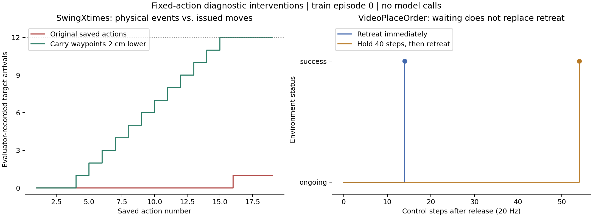

# 本机训练集实验结果与机制分析

主设计为 4 个任务 × 4 个条件，共 16 集；全部使用各任务 train episode 0，四个 episode 的元数据难度均为 easy。另有 2 集通用验证提示的探索性实验，以及 2 个不调用模型的动作干预。完整口径见 [review.md](review.md)，逐条结果和中断尝试见 [results.json](results.json)。

主实验 16/16 已完成，另两条探索性实验也已完成。共 246 次有效模型回答，另有 3 次连接失败；三条中断都通过同种子、同动作、同图像 SHA256 的回放验证恢复。网络错误不计为任务失败。主表中除 no_history PatternLock 是模型自行提前结束外，其余失败均由环境正式判定，未触及本地调用或图片上限。

| Task | full | no_dynamics | no_history | sparse16 |
|---|---|---|---|---|
| PatternLock | 失败；5 次 / 174 步 | 成功；14 次 / 299 步 | 失败；14 次 / 427 步 | 成功；11 次 / 244 步 |
| VideoPlaceOrder | 成功；7 次 / 216 步 | 成功；7 次 / 219 步 | 失败；6 次 / 214 步 | 失败；6 次 / 211 步 |
| SwingXtimes | 失败；19 次 / 654 步 | 失败；19 次 / 652 步 | 失败；20 次 / 655 步 | 失败；19 次 / 653 步 |
| ButtonUnmask | 成功；18 次 / 522 步 | 成功；21 次 / 544 步 | 失败；10 次 / 296 步 | 成功；16 次 / 493 步 |

次数为总有效模型回答数（恢复前后合计），步数为执行控制步数；模型自行结束不视为环境成功。具体结局与失败原因见 results.json。

## 哪些结论已有直接证据

### VideoPlaceOrder：目标身份要跨步骤保留，放下后还要完成结束动作

full 轨迹用 7 次模型调用、216 个执行控制步成功。它从示范确定第四个目标，保留该目标现在位于绿色方块后方的信息，然后抓取、搬运、放下、释放、抬离。no_dynamics 同样在 7 次调用后成功，因此本例没有证据证明整段通用动力学说明是必要条件。

no_history 首轮也正确识别了目标后来移动的位置。但搬运时模型明确表示早先放置序列已不可见，转而选择左下方目标；第 6 次动作后环境以放置到错误目标为由判失败。这里缺失的是历史选择结果和目标身份的持续保留，不是第一轮完全看不懂视频。

sparse16 保留历史，但首轮就把第四次放置时的左下位置当作现在仍应去的位置，随后一直执行这个选择，第 6 次动作、211 步后放错目标。与 no_history 的“首轮正确、后来丢失”不同，它的错误已经出现在首次示范解释中。记录支持检查目标后续移动和身份跟踪；尚不能精确证明是哪一帧被省略导致错误，也不能排除模型采样差异。

两组最初都收到同一段 1,313 帧源观测；full 选取 439 张 front 图，sparse16 选取 83 张，另各加一张当前 wrist。初始源帧的重叠部分经 SHA256 核对一致。

成功轨迹在释放后、第 202 个执行步仍未成功。固定前六个动作，改为保持当前姿态 40 个控制步（2 秒），状态仍为 ongoing；再执行原来的抬离动作，第 256 步成功。原轨迹直接抬离则在第 216 步成功。这个干预排除了“只需要多等一会儿”的解释，支持本轨迹中退离是完成条件的一部分。它不是关于所有可能轨迹的充分必要定理。

### SwingXtimes：动作次数不等于有效到达次数

full 在描述中累计了六次往返，19 次调用、654 步后按按钮失败，正式原因是尚未完成所要求的动作。评价器专用回放发现：十二次搬运到达后 `swing_count` 仍为 0，最后放下时才记为 1。

事后检查显示，方块中心在到达时约为 0.122–0.124 m，而有效到达的高度判据要求低于 0.12 m。TCP 在约 0.119 m 附近并不保证方块中心也满足条件。该隐藏数值仅用于诊断，没有提供给模型。

固定原始 19 个动作的其他分量，只将第 4–15 个动作的搬运高度降低 2 cm，评价器记录到十二次有效到达，最终在 649 步成功。改变的动作分量只有这段 z 值；执行耗时随轨迹相应变化。这是针对该失败机制的干预证据，**不是提示优化后的新模型成绩**。

可取之处：任务说明和训练示例需要让模型学会可观察的“到达/登记”事件；控制器需要区分手部参考点、被抓物体的位置和触发反馈。仅保留一个自述计数器无法修复物理事件定义错误。

### PatternLock：理解节点序列仍不足以保证画对

full 与 no_dynamics 首轮都识别出相同的四节点序列。full 在第二节点附近移动后直接继续下一段，5 次调用、174 步后路径不匹配。评价器专用回放显示，开始转向第三节点前，实际登记列表仍只有第一个节点。

no_dynamics 在第二、第三及最后节点未变红时进行多次接触/位置修正，14 次调用、299 步后成功。成功轨迹也不是每次“向下更多”都有效：它后来降低向下压力、重新对中才登记第三节点。这支持“检查触达后才推进”的机制，而不是简单增加动作幅度。

no_history 首轮读对序列，第二轮已无法从当前帧找回示范，随后沿网格边缘构造另一条路径，并在环境仍未成功时输出 null 自行结束。不能把这种自述完成计为成功。

本例的删减提示胜出不意味着动力学说明有害。只有一条轨迹、模型输出存在随机性，而且两条轨迹采取了不同接触动作；其确定证据是未验证的阶段推进和成功轨迹中的闭环纠错。

sparse16 在这一集仍读对节点顺序，并在触达不确定时修正，11 次调用、244 步后成功。这是“必须对所有任务使用同样高帧率”的一个反例，但不足以将稀疏采样推广到短暂揭示、穿越计数或复杂交换任务。

本例最初的 211 帧源观测，full 选取 71 张 front 图，sparse16 选取 15 张，另各一张 wrist。它比 VideoPlaceOrder 短很多，所需事件也不同，不宜把一项任务的可用采样率直接复制到另一项。

### ButtonUnmask：显色证据、身份映射和操作阶段必须衔接

full 用 18 次调用、522 步按蓝、绿、红的顺序成功操作；no_dynamics 用 21 次调用成功，途中有抓取修正。两条都先触发按钮，利用揭示信息建立目标映射，再在遮挡恢复后按顺序操作。

这两例显示通用动力学说明并非本集成功所不可缺少的提示块。更直接的成功条件候选是：看见并保留短暂提示，保持容器身份与当前目标的对应，以及提起确认后才推进顺序。历史与采样对照的完整结果见主表。

sparse16 用 16 次调用、493 步成功，说明本集稀疏样本仍保留了足够信息；这不能保证其他种子的短暂揭示也不会被漏采。

no_history 在第 10 次调用、296 步时提起了当前阶段不应提起的容器，被环境判失败；记录并未支持“只要看到当前容器就能重新识别隐藏颜色”。这与需要保留揭示映射的解释一致，但没有独立分离图像记忆与文本身份记录。

## 通用验证提示的探索性对照

| 任务 | full | full + 通用验证提醒 |
|---|---|---|
| PatternLock | 失败，5 次调用 / 174 步 | 成功，14 次调用 / 270 步 |
| SwingXtimes | 失败，19 次调用 / 654 步 | 失败，20 次调用 / 664 步 |

提醒要求计数已观察到的物理事件、在依赖后续动作前比较新观测与预期、区分身份与位置，并考虑物体在接触时的运动。它没有写任务专用阈值或节点坐标。

PatternLock 的这一条轨迹在节点仍为白色时继续修正接触，验证后再推进，最终成功。但同种子 no_dynamics 和 sparse16 也能成功；单次结果不足以隔离通用提醒的净收益。

SwingXtimes 的回答使用了“verified swings”等措辞，却仍把几何上方的位置当作已登记到达。评价器专用回放确认：十二次搬运后的计数仍为零，最后放下才增加到一。提醒没有教会模型该观察什么反馈，无法独自补足任务事件的物理语义。这一负结果对接口设计很有用：写“检查完成”不等于提供可执行的完成判据。

## 固定动作干预图

左图的计数来自评价器专用诊断。右图横轴是释放后的控制步；两条轨迹都在抬离完成后成功。可下载 [SVG](mechanism_probes.svg)，对应数据在 [probe_evidence.json](probe_evidence.json)。

## 证据边界

- 每个主表单元只有一集，不能作统计显著性、总体成功率或“必要性已被证明”的结论。
- no_history 同时移除了旧图像与旧回答；它未分离视觉记忆、文本记忆和结构化字段。上述失败不证明所有原始帧都必要。
- sparse16 同时改变事件采样和图像负担；其结果不能直接归因为纯粹的记忆容量。
- no_dynamics 移除一整段执行说明，包含时钟、动作耗时、夹爪持续状态和无步数动作的含义；它不是某一条动力学规则的独立消融。
- no_dynamics 仍保留帧间隔、测得状态、基本动作格式和模型已有知识；不能将其解释为“模型完全不知道动力学”。本轮也没有实测 StopCube，不能据此否定时机任务需要时间说明。
- 通用验证提示是事后选择任务的探索性对照。它未使用隐藏阈值，也未重跑 MEMI 的离线优化或 3-tier 的学习型监测器。
- 两个动作干预用于验证具体机制，不计入模型成功率。特别是高度干预使用了事后评价器信息。
- 未运行其他仓库的完整权重，也未做 800 集测试集评估。没有修改原 FDS adaptive campaign 或将手写任务规则并入它。

脚本编译与实机模型/仿真调用已验证。独立日志审计检查每个模型 JSON 与执行动作一致、图像 SHA256 正确、各组初始图像/种子/目标/步数预算一致；共核查 4,222 个唯一图像文件；数量与各项检查见 [verification.json](verification.json)。
